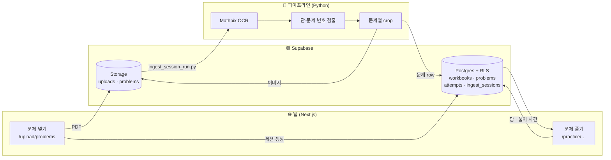

<p align="center">
  
</p>

<p align="center">
  <a href="https://nextjs.org"></a>
  <a href="https://react.dev"></a>
  <a href="https://www.typescriptlang.org"></a>
  <a href="https://supabase.com"></a>
  <a href="https://tailwindcss.com"></a>
  <a href="https://www.python.org"></a>
  
  <a href="LICENSE"></a>
</p>

<p align="center">
  <b>문제집은 많은데, 오늘 뭘 풀지 고르는 데만 10분.</b><br>
  가진 문제지를 한 번 올려 두면, 문제 하나하나가 카드처럼 쌓여서 매일 골라 풀고 기록이 남습니다.
</p>

---

## ✨ 무엇을 하나요

| | |
| --- | --- |
| 📄 **PDF 한 번 업로드** | 문제지 PDF를 올리면 원본은 비공개 저장소에 보관됩니다. |
| 🔍 **수식까지 읽는 OCR** | [Mathpix](https://mathpix.com)로 페이지를 읽어 LaTeX 수식과 줄 좌표를 뽑습니다. |
| ✂️ **문제 단위 자동 분리** | 2단 레이아웃과 문제 번호(`011`, `012` …)를 찾아 문제마다 영역을 잘라 이미지로 저장합니다. |
| 🗂️ **문제 DB** | 문제집 → 문제 구조로 쌓이고, 배점·단원·OCR 텍스트가 함께 저장됩니다. |
| ✍️ **풀이 기록** | 문제를 열고 답을 내면, 걸린 시간과 함께 내 기록으로 남습니다. |
| 🔐 **내 것만 보이게** | Supabase RLS로 내가 올린 문제집과 내 풀이 기록만 조회됩니다. |

## 🧭 어떻게 동작하나요



1. **업로드** — 웹에서 PDF를 올리면 `uploads` 버킷에 저장되고 `ingest_sessions`에 세션이 생깁니다.
2. **분리** — `scripts/ingest_session_run.py --session-id N`이 OCR → 문제 검출 → 이미지 crop → DB 적재를 순서대로 실행합니다.
3. **풀이** — 웹에서 문제를 열어 답을 내면 `attempts`에 기록됩니다.

## 🛠 기술 스택

- **Web** · Next.js 16 (App Router, Turbopack) · React 19 · TypeScript · Tailwind CSS 4
- **Backend** · Supabase — Auth(쿠키 세션, `@supabase/ssr`), Postgres + Row Level Security, Storage
- **Pipeline** · Python · Mathpix OCR API · pdf2image · Pillow

## 🚀 시작하기

### 1. Supabase 준비

1. [Supabase](https://supabase.com)에서 새 프로젝트를 만듭니다.
2. **SQL Editor**에 [`supabase/schema.sql`](supabase/schema.sql) 전체를 붙여넣고 실행합니다.
   테이블·RLS 정책·회원가입 트리거·Storage 버킷이 한 번에 만들어지고, 여러 번 실행해도 안전합니다.
3. **Authentication → Sign In / Providers**에서 **Confirm email**을 끄면 메일 인증 없이 바로 가입됩니다. (선택)

### 2. 웹 앱

```bash
git clone https://github.com/qminlab/mathhacker.git
cd mathhacker
npm install
cp .env.example .env.local
npm run dev
```

`.env.local`에 Supabase **Project Settings → API**의 값을 채운 뒤 <http://localhost:3000>을 엽니다.

| 변수 | 값 |
| --- | --- |
| `NEXT_PUBLIC_SUPABASE_URL` | Project URL |
| `NEXT_PUBLIC_SUPABASE_ANON_KEY` | anon (publishable) key |
| `SUPABASE_SERVICE_ROLE_KEY` | service_role (secret) key — 서버 전용, 절대 공개 금지 |

### 3. 관리자 지정 (선택)

가입 후 SQL Editor에서 한 번 실행하면 `/admin/workbooks`에서 모든 문제집을 볼 수 있습니다.

```sql
update public.profiles set role = 'admin'
where id = (select id from auth.users where email = 'you@example.com');
```

### 4. 파이프라인

```bash
python3 -m venv .venv && source .venv/bin/activate
pip install -r scripts/requirements.txt        # pdf2image는 poppler 필요: brew install poppler
cp .env.example .env                            # SUPABASE_URL · SERVICE_ROLE_KEY · MATHPIX 키

# 웹에서 업로드하고 받은 세션 번호로 실행
python3 scripts/ingest_session_run.py --session-id 1 \
  --source "내 문제집 SET 01" --unit "지수함수와 로그함수"
```

<details>
<summary>단계별 스크립트</summary>

| 스크립트 | 하는 일 |
| --- | --- |
| `ocr_import.py` | PDF → 페이지 PNG → Mathpix OCR JSON |
| `extract_problems_from_json.py` | 줄 좌표로 단·문제 번호를 찾아 문제별 영역 JSON 생성 |
| `crop_problems_and_add_image_file.py` | 페이지 이미지에서 문제 영역을 잘라 PNG로 저장 |
| `import_problems_to_supabase.py` | `workbooks` / `problems`에 insert (업로드한 사용자가 주인) |
| `upload_problem_images_to_storage.py` | 잘라낸 이미지를 Storage에 올리고 `full_image_url` 채우기 |
| `ingest_session_run.py` | 위 단계를 세션 하나에 대해 순서대로 실행 |

중간 결과물은 `work/`에 쌓이며 git에는 올라가지 않습니다.
</details>

## 📁 프로젝트 구조

```
src/
├─ app/
│  ├─ (auth)/            로그인 · 회원가입
│  ├─ (app)/             대시보드 · 문제 넣기 · 풀기 · 통계 · 설정 · 내 정보
│  ├─ admin/             관리자 전용 (role = admin)
│  ├─ practice/…         문제 풀이 화면
│  └─ api/               ingest/pdf · attempts · profile
├─ lib/supabase/         서버 · 브라우저 클라이언트
└─ proxy.ts              세션 갱신 + 로그인 필요 경로 보호
scripts/                 OCR · 문제 분리 파이프라인 (Python)
supabase/schema.sql      테이블 · RLS · 트리거 · 버킷
```

## 🗺 로드맵

- [x] 회원가입 · 로그인 (쿠키 세션)
- [x] PDF 업로드 → 세션 생성
- [x] OCR → 문제 분리 → crop → DB 적재 *(현재 PDF 1페이지)*
- [x] 문제 보기 · 답 제출 · 풀이 시간 기록
- [x] 대시보드 · 관리자 문제집 목록
- [ ] 업로드 후 파이프라인 자동 실행
- [ ] 여러 페이지 처리
- [ ] 답지 업로드 → 자동 채점
- [ ] 데일리 / 순서대로 출제 모드 · 타이머
- [ ] 설정 저장 · 통계 그래프
- [ ] 풀이 영역 필기(그림판)

## ⚖️ 저작권 안내

Math Hacker는 **본인이 가진 문제지를 개인 학습용으로 정리하는 도구**입니다.
시중 문제집 PDF나 그 OCR 결과를 다른 사람과 공유하거나 공개 배포하지 마세요. 이 레포에는 예제 문제지를 포함하지 않습니다.

## 📜 라이선스

코드는 [MIT License](LICENSE)로 공개합니다. 자유롭게 쓰고 고치고 배포할 수 있으며, 저작권 표시만 남겨 주세요.
(위 저작권 안내대로, 앱으로 정리한 문제지 콘텐츠는 이 라이선스에 포함되지 않습니다.)
