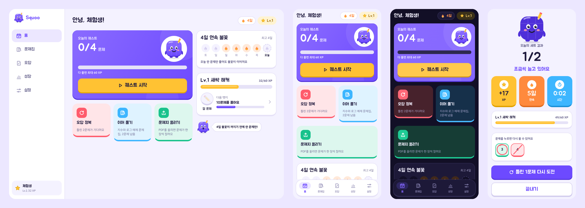
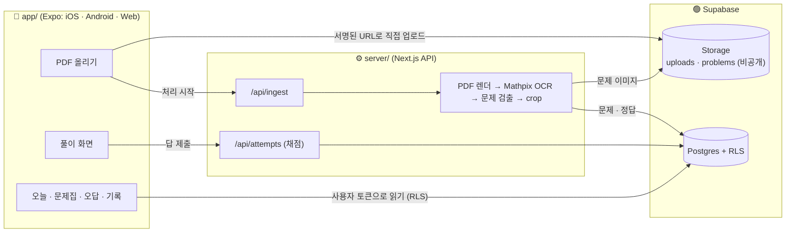

<p align="center">
  
</p>

<p align="center">
  <a href="https://expo.dev"></a>
  
  <a href="https://nextjs.org"></a>
  <a href="https://supabase.com"></a>
  <a href="https://www.typescriptlang.org"></a>
  
  <a href="LICENSE"></a>
</p>

<p align="center">
  <b>문제집은 많은데, 오늘 뭘 풀지 고르는 데만 10분.</b><br>
  가진 문제지를 한 번 올려 두거나 학년만 고르면, 마스코트 스쿠가 매일 퀘스트를 꺼내 줍니다.<br>
  펜으로 풀고, 바로 채점되고, 불꽃·XP·뱃지가 쌓여요.
</p>

<p align="center">
  
</p>

---

## ✨ 무엇을 하나요

| | |
| --- | --- |
| 📄 **문제지 한 번 올리기** | PDF를 올리면 서버가 페이지를 읽고(Mathpix OCR) 문제 번호를 찾아 문제마다 이미지로 잘라 둡니다. |
| 🔑 **답지로 자동 채점** | 빠른정답 PDF를 올리면 번호별 정답을 뽑아 넣고, 잘못 읽은 정답은 앱에서 바로 고칩니다. |
| ✍️ **펜으로 푸는 풀이판** | 문제는 왼쪽 위에, 나머지는 전부 모눈 풀이판. 애플펜슬·S펜 필압, 펜만 인식, 지우개, 되돌리기. |
| ⏱️ **시험처럼, 혹은 연습처럼** | 문제당 제한 시간(+1분), 힌트, 포기, 문제마다 바로 채점 또는 다 풀고 한꺼번에 채점. |
| ⭕ **빨간펜 채점** | 맞으면 동그라미, 틀리면 빗금. 선생님이 긋듯이 그려집니다. |
| 📅 **오늘의 세트** | 매일 안 푼 문제 중에서 정해 둔 개수만큼 골라 줍니다. 순서대로 풀기도 됩니다. |
| 📝 **오답노트** | 틀리거나 포기한 문제가 모이고, 다시 맞히면 빠집니다. |
| 📊 **기록** | 날짜별로 푼 양, 단원별 정답률(약한 단원부터), 공부한 시간. |
| 🧩 **학년별 공용 문제** | 유아~고1 단원별 문제. 코드로 만든 오리지널 문제라 저작권 걱정이 없고, 정답도 코드가 계산합니다. |
| 🎯 **수능 문제 은행** | 2028학년도 수능 범위(대수·미적분Ⅰ·확률과 통계, 2022 개정) 10,232문제(183개 유형). 기초 / 수능 기본 / 수능 4점 / 고난도 4단계, 문제마다 해설. 모든 정답은 다른 방법(완전 탐색·수치 계산)으로 다시 계산해 테스트로 맞춰 봅니다. |
| 🌙 **다크 모드** | 기기 설정을 따르고, 설정에서 라이트·다크를 직접 고를 수도 있습니다. |

화면은 **패드 → 폰 → 컴퓨터** 순서로 설계했습니다. 패드와 컴퓨터는 왼쪽 레일과 넓은 풀이판, 폰은 아래 탭 막대와 아래쪽 답 패널을 씁니다.

## 🧭 구조



- **앱**은 읽기를 Supabase에 사용자 토큰으로 직접 하고(RLS가 내 것만 보여 줌), 업로드 처리·채점·삭제처럼 권한이 필요한 일만 서버 API에 맡깁니다.
- **서버**는 화면 없이 API만 있습니다. 처리는 페이지 단위로 저장해서, 중간에 끊겨도 다시 시작하면 남은 페이지부터 이어서 합니다.
- **채점**은 서버에서만 합니다. `③ = (3) = 3`, `0.75 = 3/4` 같은 표기 차이를 같은 답으로 봅니다.

## 🚀 시작하기

필요한 것: Node.js 20+, [Supabase](https://supabase.com) 프로젝트(무료), [Mathpix](https://mathpix.com) API 키(OCR, 페이지당 과금).

### 1. Supabase

1. 프로젝트를 만들고 **SQL Editor**에 [`supabase/schema.sql`](supabase/schema.sql) 전체를 붙여넣어 실행합니다.
   처음 설치와 업그레이드 모두 이 파일 하나로 하며, 여러 번 실행해도 안전합니다.
2. **Authentication → Sign In / Providers → Email**에서 **Confirm email**을 끄면 메일 인증 없이 바로 가입됩니다.
3. (선택) 가입한 뒤 관리자로 지정하면 모든 문제집을 볼 수 있습니다.
   ```sql
   update public.profiles set role = 'admin'
   where id = (select id from auth.users where email = 'you@example.com');
   ```

### 2. 서버 (`server/`)

```bash
cd server
npm install
cp .env.example .env.local     # SUPABASE_URL, SUPABASE_ANON_KEY, SUPABASE_SERVICE_ROLE_KEY, MATHPIX_APP_ID/KEY
npm run dev                    # http://localhost:3000/api/health
```

공용 문제 넣기 (스키마를 다시 실행한 뒤, 한 번만):

```bash
npm run seed:public -- --dry        # 개수만 확인
npm run seed:public                 # 전체 학년 (그림을 그려 Storage에 올리고 문제를 저장, 여러 번 돌려도 같은 결과)
npm run seed:public -- --grades k,e1
npm run seed:public -- --grades su  # 수능 문제 은행만 (문제·해설 그림 2만 장, 몇 분 걸려요)
npm run preview:public -- ./preview 2      # 넣지 않고 PNG로 미리 보기
npm run preview:suneung -- ./preview-su 1  # 수능 문제·해설 미리 보기
```

배포는 [Vercel](https://vercel.com)에 `server/`를 Root Directory로 지정하고 같은 환경변수를 넣으면 됩니다. 처리 함수는 최대 300초로 설정돼 있습니다.

### 3. 앱 (`app/`)

```bash
cd app
npm install
cp .env.example .env.local     # EXPO_PUBLIC_SUPABASE_URL, EXPO_PUBLIC_SUPABASE_ANON_KEY, EXPO_PUBLIC_API_URL
npx expo start                 # i: iOS 시뮬레이터, a: 안드로이드, w: 웹
```

- 서버 없이 화면만 보려면 `npm run demo` (예제 문제로 도는 체험 모드).
- 실제 폰·패드에서 개발 서버에 붙이려면 `EXPO_PUBLIC_API_URL`을 맥의 같은 와이파이 주소(예: `http://192.168.0.10:3000`)로 둡니다.
- 펜 필기·문서 선택 같은 네이티브 기능은 Expo Go 대신 개발 빌드(`eas build --profile development`)에서 확인하는 게 정확합니다.

## 📦 스토어 출시 (EAS)

앱 ID는 iOS `com.qminlab.squoo`, Android `com.qminlab.squoo`입니다 ([`app/app.json`](app/app.json)).

```bash
cd app
npm i -g eas-cli
eas login
eas init                                       # Expo 프로젝트 연결 (app.json에 projectId가 들어감)

# 빌드에 들어갈 환경변수 (EXPO_PUBLIC_ 값은 앱에 그대로 포함되니 공개 키만)
eas env:create --environment production --name EXPO_PUBLIC_SUPABASE_URL --value https://xxxx.supabase.co --visibility plaintext
eas env:create --environment production --name EXPO_PUBLIC_SUPABASE_ANON_KEY --value <anon key> --visibility plaintext
eas env:create --environment production --name EXPO_PUBLIC_API_URL --value https://<배포한 서버> --visibility plaintext

eas build --platform all --profile production
eas submit --platform ios       # Apple 계정으로 로그인하면 App Store Connect 앱을 찾거나 만들어 준다
eas submit --platform android   # Play Console 앱 + 서비스 계정 키 필요, 처음엔 internal 트랙
```

심사 전에 준비할 것:

- **개인정보처리방침 URL**: 이메일, 올린 PDF, 풀이 기록을 저장한다는 내용. 두 스토어 모두 필수입니다.
- **심사용 테스트 계정**: 문제집이 하나 이상 들어 있는 계정을 App Review 정보에 적어 둡니다.
- **계정 삭제**는 앱 안 설정 화면에 있습니다 (Apple 가이드라인 5.1.1(v)).
- 스크린샷: 12.9·13인치 iPad, 6.9인치 iPhone, 안드로이드 폰·태블릿.

## 📁 프로젝트 구조

```
app/                         Expo 앱 (iOS · Android · Web)
├─ src/app/                  화면 (expo-router)
│  ├─ (auth)/                로그인 · 가입
│  ├─ (app)/                 오늘 · 문제집 · 오답노트 · 기록 · 설정 (레일 / 탭 막대)
│  ├─ practice/[sessionId]   풀이 화면
│  └─ upload                 PDF 올리기
├─ src/features/             풀이판, 답 패드, 차트, 업로드 상태 …
├─ src/lib/                  Supabase · API · 데이터 훅 · 체험 모드
└─ src/ui/                   디자인 토큰, 모눈종이, 채점 표시, 기본 컨트롤
server/                      Next.js API
├─ src/app/api/              ingest · attempts · workbooks · account · health
└─ src/lib/pipeline/         PDF 렌더, Mathpix, 문제 검출, 답지 파서, 처리 엔진
supabase/schema.sql          테이블 · RLS · 함수 · Storage 정책
```

테스트: `cd server && npm test` (채점 규칙, 답지 파서, 문제 검출, 처리 엔진 재시도).

## 🗺 로드맵

- [x] 문제지 PDF → 문제 자동 분리 (40쪽까지, 서버에서)
- [x] 빠른정답 OCR + 직접 수정, 자동 재채점
- [x] 오늘의 세트 · 순서대로 · 오답노트
- [x] 펜 풀이판, 타이머, 힌트, 포기, 즉시 / 일괄 채점
- [x] 기록 (일별, 단원별)
- [x] iPad · iPhone · Android · 웹, 앱 안 계정 삭제
- [ ] 문제 번호 형식이 다른 문제지 (①, 1., 예제 1 …)
- [ ] 해설지 PDF로 문제별 힌트·해설
- [ ] 풀이판 필기 다시 보기
- [ ] 오프라인에서 풀고 나중에 동기화

## ⚖️ 저작권 안내

Squoo는 **본인이 가진 문제지를 개인 학습용으로 정리하는 도구**입니다. 올린 문제지와 잘라 낸 문제 이미지는 올린 사람만 볼 수 있습니다.
시중 문제집 PDF나 그 OCR 결과를 다른 사람과 공유하거나 공개 배포하지 마세요. 이 레포의 예제 문제(`app/assets/demo`)와 공용 문제(`server/src/lib/generate`)는 직접 만든 문제입니다. 수능·모의고사 기출은 평가원·교육청에 저작권이 있어 공용으로 넣지 않으며, 가진 사람이 직접 올려 혼자 보는 용도로만 쓰세요.
문제 그림에 쓰는 글꼴 IBM Plex Sans KR은 [SIL OFL](server/assets/fonts/OFL.txt)을 따릅니다.

## 라이선스

[MIT](LICENSE)
